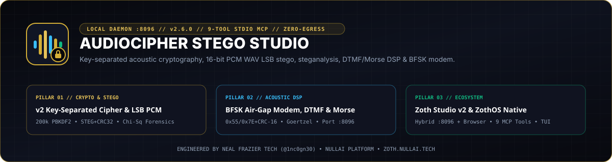

<div align="center">
  
</div>

# AudioCipher Stego Studio (`audiocipher-stego-engine`)

Audio-keyed encryption (v2 key-separated PBKDF2-HMAC-SHA256), 16-bit PCM WAV LSB/parity steganography, statistical steganalysis, ITU Morse & DTMF synthesis/decoding, and audible/ultrasonic BFSK acoustic modem toolkit with zero external Python runtime dependencies.

- **Repositories**: `https://github.com/1nc0gn30/audiocipher-stego-engine` • `https://github.com/NullAITech/audiocipher-stego-engine`
- **Zoth Studio v2 Dossier**: `https://zoth.nullai.tech/tools/audiocipher-stego-engine`
- **Local Workstation**: `http://127.0.0.1:8096`
- **Version**: `2.6.0`
- **Author**: Neal Frazier Tech (`@1nc0gn30`) • NullAI Platform (`https://nullai.tech`)
- **License**: MIT (100% free and open-source; zero paywalls)

---

## What It Does & How It Works

AudioCipher Stego Studio implements acoustic cryptography and waveform signal processing in both Python 3.9+ standard-library modules and a dual-theme, zero-egress WebAudio/Canvas workstation (`public/index.html`) that automatically dispatches to the live loopback daemon (`127.0.0.1:8096`) when reachable and falls back seamlessly to wire-compatible in-browser execution offline:

- **Audio-Keyed Encryption (`crypto_core.py`)**: Derives a 256-bit master key via PBKDF2-HMAC-SHA256 (`200,000` iterations) from a 16-bit PCM WAV waveform plus a finite `volume_db` modifier, then derives independent domain-separated `enc_key` (`HMAC-SHA256(master, "audiocipher-enc-v2")`) and `mac_key` (`HMAC-SHA256(master, "audiocipher-mac-v2")`) subkeys under versioned `AC2\x02` Encrypt-then-MAC framing (retaining backward-compatible decryption for legacy v1 ciphertexts).
- **16-bit PCM WAV Steganography (`stego_engine.py`, `wav_codec.py`)**: Embeds and extracts arbitrary binary payloads in 16-bit PCM WAV sample LSBs (`STEG` + little-endian uint32 length + CRC-32) and parity blocks (`PARI`), with `MAX_WAV_FRAMES = 4,800,000` header-bomb protection.
- **Forensic Statistical Steganalysis (`steganalysis.py`)**: Performs Pairs-of-Values (PoV) chi-square testing, LSB entropy anomaly inspection, and ultrasonic energy ratio analysis on 16-bit PCM WAV carriers.
- **Morse & DTMF Codecs (`spectrogram.py`)**: Synthesizes ITU Morse WAV audio at configurable frequency and WPM, plus dual-tone multi-frequency (DTMF) synthesis and Goertzel frequency decoding.
- **Acoustic BFSK Modem (`acoustic_modem.py`)**: Modulates and demodulates framed binary payloads over audible (1200/2200 Hz) or ultrasonic (18.5/20.0 kHz) continuous-phase BFSK with `0x55` preamble, `0x7E` frame sync delimiter, 2-byte big-endian length header, and CRC-16-CCITT verification.
- **Hardened Loopback Daemon (`ui_server.py`)**: Strict loopback `Host` and `Origin` allowlists (blocking DNS rebinding and port-suffix domain spoofs with `403 JSON` and `Vary: Origin`), security headers (`X-Frame-Options`, `Content-Security-Policy: frame-ancestors`, `X-Content-Type-Options`, `Referrer-Policy`), `MAX_BODY_BYTES = 1,572,864` (`413 JSON`), `HEAD` support, symlink/traversal rejection (`403 JSON`), and centralized `400`/`422` JSON validation.

---

## Architecture

```
audiocipher-stego-engine/
├── bin/
│   ├── audiocipher-stego-engine           # Unified ZothOS CLI wrapper (/opt + ~/NullAITech)
│   ├── audiocipher-stego-engine-tui       # Live :8096 Unicode U+2800 Braille Telemetry TUI
│   └── audiocipher.js                     # Optional Node / Electron launcher
├── systemd/
│   └── audiocipher-stego-engine.service   # Hardened loopback systemd unit (:8096)
├── src/audiocipher_stego_engine/
│   ├── crypto_core.py                     # v2 key-separated PBKDF2-HMAC-SHA256 cipher + v1 compat
│   ├── wav_codec.py                       # Pure-stdlib 16-bit PCM WAV codec (4.8M frame cap)
│   ├── stego_engine.py                    # STEG+CRC32 LSB & parity-block WAV steganography
│   ├── steganalysis.py                    # PoV chi-square & HF forensic steganalysis
│   ├── spectrogram.py                     # ITU Morse & DTMF Goertzel codec
│   ├── acoustic_modem.py                  # Audible & ultrasonic BFSK modem (0x55/0x7E + CRC-16)
│   ├── ui_server.py                       # Hardened loopback HTTP server on 127.0.0.1:8096
│   ├── mcp_server.py                      # Hardened JSON-RPC 2.0 stdio MCP server (9 tools)
│   └── cli.py                             # Command-line interface (`audiocipher` / `audio-stego`)
├── public/                                # Zero-egress dual-theme WebAudio workstation
├── server.py                              # Standalone loopback daemon entrypoint (:8096)
└── tests/                                 # Pytest security, crypto, stego, modem, MCP & HTTP suites
```

### REST API Endpoints (`http://127.0.0.1:8096`)

| Method | Path | Description |
| :--- | :--- | :--- |
| `GET` / `HEAD` | `/health` (`/api/health`) | Service health status, version (`2.6.0`), and uptime |
| `GET` / `HEAD` | `/api/diagnostics` | Runtime, v2 crypto parameters, body cap, and MCP tool count |
| `POST` | `/api/encrypt` | Encrypt payload with base64 audio key and `volume_db` (v2 key-separated) |
| `POST` | `/api/decrypt` | Authenticate and decrypt v2 or legacy v1 ciphertext blob |
| `POST` | `/api/stego/embed` | Embed payload (`STEG` + LE len + CRC-32) into PCM WAV carrier |
| `POST` | `/api/stego/extract` | Extract and verify hidden LSB payload from PCM WAV carrier |
| `POST` | `/api/steganalysis` | Run forensic PoV chi-square & HF steganalysis on a WAV carrier |
| `POST` | `/api/morse` | Synthesize ITU Morse 16-bit PCM WAV audio from text |
| `POST` | `/api/dtmf/synthesize` | Synthesize DTMF keypad tones to 16-bit PCM WAV |
| `POST` | `/api/dtmf/decode` | Decode DTMF digits from WAV audio via Goertzel filter |
| `POST` | `/api/fsk-modulate` | Modulate payload over audible or ultrasonic BFSK WAV (`0x55/0x7E` + CRC-16) |
| `POST` | `/api/fsk-demodulate` | Demodulate BFSK WAV audio back into CRC-16 verified payload |

---

## Quickstart

```bash
git clone https://github.com/1nc0gn30/audiocipher-stego-engine.git
cd audiocipher-stego-engine

# Start the local web server on 127.0.0.1:8096
python3 server.py --host 127.0.0.1 --port 8096
# or via unified ZothOS CLI:
audiocipher-stego-engine serve --port 8096
```

Verify the server from another terminal:

```bash
curl -s http://127.0.0.1:8096/health
curl -s http://127.0.0.1:8096/api/diagnostics
```

---

## ZothOS CLI, Braille TUI & MCP Commands

### CLI Subcommands (`audiocipher-stego-engine` / `audiocipher`)

```bash
# Status, version, diagnostics, and internal self-test
audiocipher-stego-engine --help
audiocipher-stego-engine --version
audiocipher-stego-engine --status --json
audiocipher-stego-engine doctor
audiocipher-stego-engine test-self

# Audio-keyed file encryption & decryption (v2 key-separated)
audiocipher encrypt secret.txt -k carrier.wav --volume 42.5 -o secret.enc
audiocipher decrypt secret.enc -k carrier.wav --volume 42.5 -o recovered.txt

# 16-bit PCM WAV LSB steganography & forensic steganalysis
audiocipher embed secret.txt -o stego.wav
audiocipher extract stego.wav -o extracted.txt
audiocipher steganalysis stego.wav --json

# ITU Morse synthesis & BFSK acoustic modem
audiocipher morse "CQ DE ZOTH" --freq 800 --wpm 20 -o morse.wav
audiocipher modem modulate "AIRGAP PACKET" --baud 300 --ultrasonic -o packet.wav
audiocipher modem demodulate packet.wav --baud 300 --ultrasonic --json

# Launch Web UI daemon or stdio MCP server
audiocipher-stego-engine serve --host 127.0.0.1 --port 8096
audiocipher-stego-engine mcp
```

### Live `:8096` Braille Telemetry TUI

```bash
audiocipher-stego-engine-tui --status
audiocipher-stego-engine-tui --json
audiocipher-stego-engine-tui --watch
```

### MCP Server (`audiocipher-stego-engine mcp`)

Exposed JSON-RPC 2.0 stdio tools (`9` tools, protocol `2024-11-05`):

1. `audio_encrypt` — Encrypt text/base64 payload using an audio file key and `volume_db`.
2. `audio_decrypt` — Authenticate and decrypt an audio-keyed ciphertext blob (v2 & legacy v1).
3. `audio_stego_embed` — Hide a payload inside a 16-bit PCM WAV carrier (`STEG` + CRC-32).
4. `audio_stego_extract` — Recover an embedded payload from a WAV carrier.
5. `audio_morse_synthesize` — Generate ITU Morse notation and base64 WAV audio.
6. `audio_diagnostics` — Return platform, v2 crypto, and codec health telemetry.
7. `audio_steganalysis` — Run forensic PoV chi-square & HF steganalysis on WAV data.
8. `audio_modulate_fsk` — Modulate payload bytes into audible/ultrasonic BFSK WAV audio.
9. `audio_demodulate_fsk` — Demodulate BFSK WAV audio back into CRC-16 verified payload.

---

## Testing & Verification

```bash
PYTHONPATH=src python3 -m pytest -v tests
```

---

## Support

This project is 100% free and open-access with zero paywalls or feature gates. Optional support:

- ☕ **Buy Us a Coffee (Stripe)**: [https://buy.stripe.com/3cIfZg27PdKo2D64Ocfw40X](https://buy.stripe.com/3cIfZg27PdKo2D64Ocfw40X)
- ◎ **Solana Tip Address**: `GG2eQbVh8ut1BK6j1A2tz7pSySdLpD38BgyEhGcxdXoK` (`solana:GG2eQbVh8ut1BK6j1A2tz7pSySdLpD38BgyEhGcxdXoK`)

## License

MIT License — Engineered by **Neal Frazier Tech** (`@1nc0gn30`) • **NullAI Platform** (`https://nullai.tech`).
