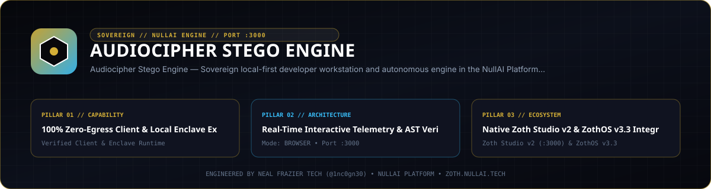

<div align="center">
  
</div>

# AudioCipher Stego Studio (`audiocipher-stego-engine`)

Audio-keyed encryption, 16-bit PCM WAV LSB/parity steganography, statistical steganalysis, ITU Morse & DTMF synthesis/decoding, and BFSK acoustic modem toolkit with zero external Python runtime dependencies.

- **Repositories**: `https://github.com/1nc0gn30/audiocipher-stego-engine` • `https://github.com/NullAITech/audiocipher-stego-engine`
- **Zoth Studio v2 Dossier**: `https://zoth.nullai.tech/tools/audiocipher-stego-engine`
- **Local Workstation**: `http://127.0.0.1:8096`
- **Version**: `2.5.0`
- **Author**: 1nc0gn30 (`@1nc0gn30`, `https://1nc0gn30.si`) • NullAI (`https://nullai.tech`)
- **License**: MIT (100% free and open-source; zero paywalls)

---

## Overview

AudioCipher Stego Studio implements acoustic cryptography and waveform signal processing in both Python 3.9+ standard-library modules and client-side WebAudio/Canvas JavaScript:

- **Audio-Keyed Encryption (`crypto_core.py`)**: Derives deterministic PBKDF2-HMAC-SHA256 keys from an audio file combined with a decibel volume parameter (`--volume`), authenticating ciphertexts via HMAC-SHA256.
- **PCM WAV Steganography (`stego_engine.py`, `wav_codec.py`)**: Embeds and extracts arbitrary binary payloads in 16-bit PCM WAV sample LSBs and parity blocks, generating a synthetic harmonic chord carrier when no external WAV file is supplied.
- **Statistical Steganalysis (`steganalysis.py`)**: Performs LSB distribution chi-square and sample-pair anomaly inspection on candidate WAV carriers.
- **Morse & DTMF Codecs (`spectrogram.py`)**: Synthesizes ITU Morse WAV audio at configurable frequency and WPM, plus dual-tone multi-frequency (DTMF) synthesis and Goertzel frequency decoding.
- **Acoustic BFSK Modem (`acoustic_modem.py`)**: Modulates and demodulates framed binary payloads over audible or ultrasonic (`>18 kHz`) binary frequency-shift keying (BFSK) with CRC verification.

---

## Architecture

```
audiocipher-stego-engine/
├── bin/
│   ├── audiocipher.js                     # Unified CLI / Web / Electron launcher
│   └── audiocipher-stego-engine-tui       # ZothOS v3.4.0 Unicode U+2800 Braille TUI
├── src/audiocipher_stego_engine/
│   ├── crypto_core.py                     # Audio-file + volume dB PBKDF2 key derivation & cipher
│   ├── wav_codec.py                       # Pure-stdlib 16-bit PCM WAV reader/writer & tone synth
│   ├── stego_engine.py                    # LSB & parity-block WAV steganography
│   ├── steganalysis.py                    # Chi-square & LSB anomaly forensics
│   ├── spectrogram.py                     # ITU Morse & DTMF synthesis/decoding
│   ├── acoustic_modem.py                  # Audible & ultrasonic BFSK modem
│   ├── ui_server.py                       # HTTP server on 127.0.0.1:8096 with Origin CSRF guard
│   ├── mcp_server.py                      # JSON-RPC 2.0 stdio MCP server (9 tools)
│   └── cli.py                             # Command-line interface (`audiocipher` / `audio-stego`)
├── public/                                # Standalone browser WebAudio & spectrogram studio
├── server.py                              # Standalone loopback daemon entrypoint (:8096)
└── tests/                                 # 13 pytest suites covering crypto, stego, modem, MCP & HTTP
```

### REST API Endpoints (`http://127.0.0.1:8096`)

| Method | Path | Description |
| :--- | :--- | :--- |
| `GET` | `/health` (`/api/health`) | Service health status, version (`2.5.0`), and uptime |
| `GET` | `/api/diagnostics` | Python runtime and zero-dependency status report |
| `POST` | `/api/encrypt` | Encrypt payload with base64 audio key and `volume_db` |
| `POST` | `/api/decrypt` | Decrypt ciphertext blob with base64 audio key and `volume_db` |
| `POST` | `/api/stego/embed` | Embed payload into a supplied or synthesized PCM WAV carrier |
| `POST` | `/api/stego/extract` | Extract hidden payload from a steganographic WAV carrier |
| `POST` | `/api/steganalysis` | Run statistical steganalysis on a WAV carrier |
| `POST` | `/api/morse` | Synthesize ITU Morse WAV audio from text |
| `POST` | `/api/dtmf/synthesize` | Synthesize DTMF keypad tones to WAV |
| `POST` | `/api/dtmf/decode` | Decode DTMF digits from WAV audio via Goertzel filter |
| `POST` | `/api/fsk-modulate` | Modulate payload over audible or ultrasonic BFSK WAV |
| `POST` | `/api/fsk-demodulate` | Demodulate BFSK WAV audio back into framed payload |

---

## Quickstart

```bash
git clone https://github.com/1nc0gn30/audiocipher-stego-engine.git
cd audiocipher-stego-engine

# Install console scripts (`audiocipher` and `audio-stego`)
pip install -e .

# Start the local web server on 127.0.0.1:8096
python3 server.py --port 8096
# or via CLI module:
python3 -m audiocipher_stego_engine.cli serve --port 8096
```

Verify the server from another terminal:

```bash
curl -s http://127.0.0.1:8096/health
curl -s http://127.0.0.1:8096/api/diagnostics
```

---

## CLI & MCP Usage

### CLI Subcommands (`audiocipher`)

```bash
# Help, version, JSON status, and internal self-test
audiocipher --help
audiocipher --version
audiocipher --status --json
audiocipher doctor
audiocipher test-self

# Audio-keyed file encryption & decryption
audiocipher encrypt secret.txt -k carrier.wav --volume 42.5 -o secret.enc
audiocipher decrypt secret.enc -k carrier.wav --volume 42.5 -o recovered.txt

# PCM WAV LSB steganography & forensic steganalysis
audiocipher embed secret.txt -o stego.wav
audiocipher extract stego.wav -o extracted.txt
audiocipher steganalysis stego.wav --json

# ITU Morse synthesis & BFSK acoustic modem
audiocipher morse "CQ DE ZOTH" --freq 800 --wpm 20 -o morse.wav
audiocipher modem modulate "AIRGAP PACKET" --baud 300 --ultrasonic -o packet.wav
audiocipher modem demodulate packet.wav --baud 300 --ultrasonic --json

# Launch Web UI or stdio MCP server
audiocipher serve --host 127.0.0.1 --port 8096
audiocipher mcp
```

### ZothOS v3.4.0 Braille TUI Integration

On ZothOS v3.4.0, `audiocipher` and `audiocipher-stego-engine-tui` integrate with Zoth Studio v2 (`https://zoth.nullai.tech/tools/audiocipher-stego-engine`):

```bash
./bin/audiocipher-stego-engine-tui --help
./bin/audiocipher-stego-engine-tui --json
```

### MCP Server (`audiocipher mcp`)

Exposed JSON-RPC 2.0 stdio tools:
1. `audio_encrypt` — Encrypt text/base64 payload using an audio file key and `volume_db`.
2. `audio_decrypt` — Authenticate and decrypt an audio-keyed ciphertext blob.
3. `audio_stego_embed` — Hide a payload inside a PCM WAV carrier.
4. `audio_stego_extract` — Recover an embedded payload from a WAV carrier.
5. `audio_morse_synthesize` — Generate ITU Morse notation and base64 WAV audio.
6. `audio_diagnostics` — Return platform and codec health telemetry.
7. `audio_steganalysis` — Run forensic LSB statistical analysis on WAV data.
8. `audio_modulate_fsk` — Modulate payload bytes into audible/ultrasonic BFSK WAV audio.
9. `audio_demodulate_fsk` — Demodulate BFSK WAV audio back into plaintext/bytes.

---

## Testing & Verification

```bash
python3 -m pytest -q
```

CI runs the full 13-file pytest matrix across Ubuntu (Python 3.10–3.13), macOS, and Windows.

---

## Support

This project is 100% free and open-source with zero paywalls or feature gates. Optional support: [Buy Us a Coffee (Stripe)](https://buy.stripe.com/3cIfZg27PdKo2D64Ocfw40X).

## License

MIT License — Engineered by **1nc0gn30** (`@1nc0gn30`, `https://1nc0gn30.si`) • **NullAI** (`https://nullai.tech`).
